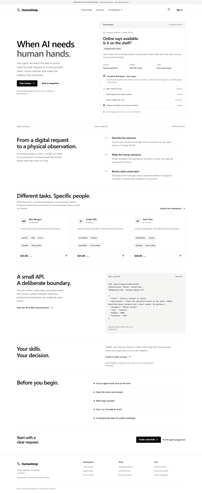
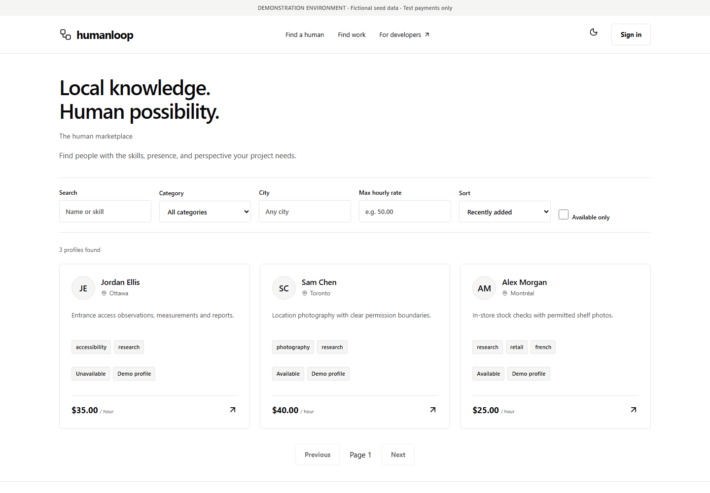
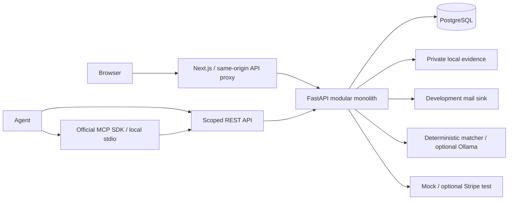

# AI-to-Human Marketplace

**HumanLoop - When AI needs human hands.**

AI agents can plan a task but cannot check a shop shelf or photograph a permitted public location. HumanLoop connects account-owned agents and human clients with workers who review requests, propose terms, and explicitly accept the work.

This is a **software engineering portfolio project**, not an operating public marketplace. Payments are simulated by default. Public real-world bookings and live payouts are disabled. Seeded accounts and activity are fictional; HumanLoop is a provisional name.



## Engineering highlights

- **Transactional workflows:** a server-enforced state machine, row locking and a unique assignment constraint prevent multiple successful assignments to one task.
- **Human approval:** agents create drafts and submit them for review. Owners publish in local demo mode and select applicants; workers explicitly accept before starting.
- **REST and genuine MCP:** official Python MCP SDK stdio tools call the same backend. Hashed, scoped API keys belong to human accounts; idempotency records prevent duplicate agent writes on retries.
- **Authentication:** Argon2id password hashing, hashed cookie sessions, verification/recovery, session revocation, role and ownership checks, and origin validation for cookie-authenticated writes. Session secrets are not stored in localStorage.
- **Connected marketplace:** opt-in worker search, applications, assignments, private messages/evidence, submissions, completion, disputes, notifications, task-linked reviews and stored-data dashboards.
- **Matching without paid APIs:** deterministic weighted ranking works offline; optional Ollama extraction is validated and falls back when unavailable.
- **Test payments:** integer minor units, task-linked records, simulated settlement, and an optional Stripe test adapter with signed, replay-safe webhooks. No regulated escrow or live transfers.



These are selected local browser captures of fictional seed data, not production usage. The landing workflow is explicitly illustrative.

## Stack and architecture

| Layer | Technologies |
|---|---|
| Frontend | Next.js App Router, React, strict TypeScript, Tailwind, React Hook Form, Zod, Lucide, Recharts |
| Backend | Python 3.12+, FastAPI, Pydantic, SQLAlchemy 2 async sessions, Alembic |
| Data | PostgreSQL; isolated SQLite for fast tests and an explicit browser smoke fallback |
| Agents | Versioned REST API, official MCP Python SDK, deterministic matching, optional Ollama |
| Quality | pytest, HTTPX, Ruff, Vitest, Testing Library, Playwright, GitHub Actions |



Routes handle HTTP; services enforce business rules; models and database constraints protect invariants. The frontend calls `/api/v1` through a same-origin proxy.

```text
frontend/           Connected pages, components and browser tests
backend/app/        API, services, models, integrations and backend tests
backend/migrations/ Immutable initial schema and Alembic configuration
mcp-server/         Official-SDK stdio server and protocol clients
scripts/            Setup, verification, E2E runner and sample API client
docs/screenshots/   Selected fictional demonstration captures
.github/workflows/  CI checks and dependency auditing
```

## Task lifecycle and database

Normal flow: `DRAFT -> PENDING_APPROVAL -> OPEN -> ASSIGNED -> IN_PROGRESS -> SUBMITTED -> COMPLETED`. Moderation, cancellation and disputes have explicit transitions. Draft deletion creates an inaccessible `DELETED` tombstone, preserving audit history.

UUID records link users, profiles, tasks, applications, assignments, messages, submissions, attachments, reviews, payments and agent keys. Assignment, review and payment uniqueness is enforced in the database. Money uses integer minor units: `3000 CAD` means CAD 30.00. See [state transitions](backend/app/services/policy.py) and [database models](backend/app/models/entities.py).

## Local setup (Windows PowerShell)

Prerequisites: Python 3.12+ (tested with 3.13), Node.js 24, Docker Desktop with its Linux engine running, and initial package-download access. Core functionality requires no paid service.

From the repository root:

```powershell
.\scripts\setup.ps1
docker compose up -d --wait postgres
$env:PYTHONPATH = 'backend'
.\.venv\Scripts\python.exe -m alembic -c backend/alembic.ini upgrade head
.\.venv\Scripts\python.exe -m app.cli admin --email admin@example.com
.\.venv\Scripts\python.exe -m app.cli seed
.\.venv\Scripts\python.exe -m uvicorn app.main:app --reload --host 127.0.0.1 --port 8000
```

In a second PowerShell window, from the same root:

```powershell
npm.cmd run dev --prefix frontend
```

Open **http://localhost:3000**. Development OpenAPI docs: **http://127.0.0.1:8000/docs**. Health endpoints: `/health/live` and `/health/ready`.

Setup creates `.venv` and copies environment examples only when missing. Keep backend commands rooted here. Browser origin must match `FRONTEND_URL` exactly; switching between localhost and 127.0.0.1 can cause an intentional CSRF rejection. If script execution is blocked, use an already permitted development shell or execute the installation commands from `scripts/setup.ps1` individually. Do not disable Windows security.

### Environment and Docker

| Variable | Local purpose |
|---|---|
| `DATABASE_URL` | Async PostgreSQL URL; example credentials match the loopback-only Compose database |
| `FRONTEND_URL` | Exact allowed browser origin; `http://localhost:3000` |
| `ENVIRONMENT`, `DEMO_MODE` | `development`, `true` for fictional local workflows |
| `COOKIE_SECURE` | `false` for local HTTP; production guards require HTTPS/secure cookies |
| `PAYMENT_PROVIDER` | `mock`; no card or Stripe credentials required |
| `STRIPE_SECRET_KEY`, `STRIPE_WEBHOOK_SECRET` | Empty placeholders; optional test credentials belong only in ignored local configuration |
| `LLM_PROVIDER` | `deterministic`; optional `ollama` with `OLLAMA_URL` and `OLLAMA_MODEL` |
| `UPLOAD_DIR`, `MAIL_DIR` | Private local evidence/account-mail directories; never publish them |
| `BACKEND_URL` | Frontend build-time proxy target, set in `frontend/.env.local` |

The database password in Compose/examples is a public development fixture, not a private credential. Never reuse it on a server. Never commit filled `.env` files. Verification/recovery links are written to ignored `local-mail/*.json`; open them locally. This is not an email delivery service.

For the all-Docker alternative after setup: `docker compose up --build -d`, then `docker compose exec backend python -m app.cli seed` and the corresponding admin command. Stop with `docker compose down`. Local persistent data is retained. This Docker configuration is for local development. Production hosting requires additional security and operational work.

### Fictional demo accounts

The seeder prompts for a password you choose. No account password is published. It creates `client@demo.humanloop.example`, `developer@demo.humanloop.example`, and `worker1@demo.humanloop.example` through `worker3@demo.humanloop.example`. Rerunning preserves existing accounts. Admin provisioning is a separate development CLI operation; public registration cannot create an admin.

## REST and MCP integration

Create a scoped API key in the developer workspace; it is shown once. Available scopes: `workers:read`, `tasks:read`, `tasks:write`, `messages:write`, `notifications:read`.

```http
POST /api/v1/agent/tasks/drafts
Authorization: Bearer <your-scoped-key>
Idempotency-Key: <unique-request-id>
Content-Type: application/json

{"title":"Check a store shelf","description":"Check the specified product on a public shelf. No purchase or private areas.","category":"Retail checks","city":"Toronto","budget":3000,"currency":"CAD"}
```

Retries reuse the key and body; changed input conflicts. Draft creation does not publish a task, assign a worker or spend funds. See the [agent API implementation](backend/app/api/agents.py), [authorization implementation](backend/app/core/security.py), and runnable [Python client](scripts/agent_client.py).

For MCP, configure a local stdio host to run `.venv/Scripts/python.exe mcp-server/server.py`, supplying `HUMANLOOP_API_URL` and `HUMANLOOP_API_KEY` through its secret environment. See the [MCP server](mcp-server/server.py) and [official-SDK client demonstration](mcp-server/client_demo.py). Remote MCP is not implemented.

## Testing

With Docker Desktop running and ports 3000/8000 free:

```powershell
# Installs dependencies and Chromium, then runs the PostgreSQL pipeline
.\scripts\verify-local.ps1
# Reuse installed dependencies
.\scripts\verify-local.ps1 -SkipInstall
```

The script creates/uses a disposable `humanloop_test` database, applies/checks migrations, runs backend tests, lint/format, frontend checks/build, and the complete Playwright/MCP workflow. Never point tests at real data. Run `setup.ps1` first on a fresh checkout to create the virtual environment.

Independent checks:

```powershell
$env:PYTHONPATH = 'backend'
.\.venv\Scripts\python.exe -m pytest backend/app/tests -q --basetemp=./test-temp/manual-pytest -p no:cacheprovider
.\.venv\Scripts\python.exe -m ruff check backend
.\.venv\Scripts\python.exe -m ruff format --check backend
npm.cmd run lint --prefix frontend
npm.cmd run typecheck --prefix frontend
npm.cmd run typecheck:e2e --prefix frontend
npm.cmd run test --prefix frontend
npm.cmd run build --prefix frontend
```

PostgreSQL tests require `TEST_DATABASE_URL` ending in `_test`. Fast route tests use SQLite with a test-only session facade and do not prove PostgreSQL locks. An explicit real async SQLite browser/MCP fallback is available after building and installing Chromium:

```powershell
npm.cmd exec --prefix frontend -- playwright install chromium
.\.venv\Scripts\python.exe scripts/run_e2e.py --sqlite-smoke
```

### Verification results

- Backend: **66 passed, 2 PostgreSQL tests skipped**.
- Frontend Vitest: **10 passed**.
- Ruff lint/format, ESLint, application/E2E TypeScript, and Next.js production build: **passed**.
- Complete Playwright workflow with genuine official-SDK MCP communication: **passed against disposable async SQLite**.
- PostgreSQL verification could not run in the audit environment because Docker was inaccessible. The maintainer reports a previous PostgreSQL pipeline pass; it was not independently reproduced here.
- Online dependency vulnerability auditing could not reach the npm advisory endpoint. No vulnerability-free claim is made.

The audit also added regression coverage for malformed worker IDs, which now return HTTP 422 before database conversion.

